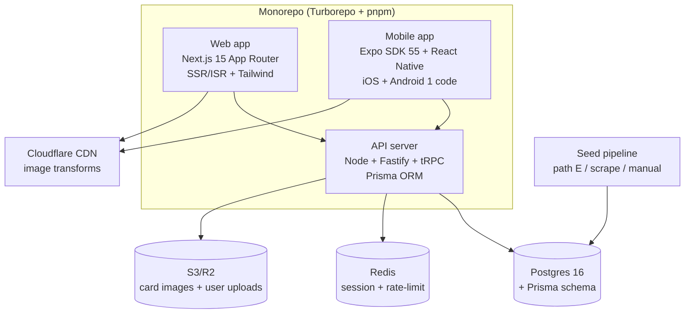

# Đề xuất hệ sinh thái eFootball — web + mobile app

> **Ngày:** 2026-09-28
> **Yêu cầu:** Hệ sinh thái gồm web + mobile app. **Giao diện tham khảo efootbase.com** (card-centric, clean DB tra cứu). **Chức năng tham khảo đầy đủ efhub.com** (player DB + manager + compare + tier list + community feed + articles + tournaments + packs + new players + pro + build simulator).
> **Stack chốt:** Next.js (web) + Expo/React Native (mobile) + Node + Postgres + Prisma + tRPC (backend).
> **Data:** Tạm tải vài bản trial để thử nghiệm rồi tính sau (xem §9 — khuyến nghị Path E seed, nhưng MVP chỉ cần seed nhỏ).

---

## TL;DR kiến trúc



**Monorepo 3 package + shared:** web, mobile, api, `packages/shared` (tRPC types + zod schema + i18n + theme tokens). Một nguồn sự thật về kiểu/type, web và mobile cùng dùng.

---

## 1. Tại sao stack này

| Yêu cầu | Giải pháp | Lý do |
|---------|-----------|-------|
| Web SEO như efootbase (index 45k card) | Next.js App Router SSR/ISR | RSC payload, sitemap, hreflang 18 locale — đúng efootbase/efhub đang dùng |
| Mobile iOS+Android 1 code, nhanh ra | Expo SDK 55 (RN newArch) | Efhub app thực tế đang dùng Expo (xác minh qua APK). React Native native perform, Expo dễ build EAS. |
| Cùng ngôn ngữ web+mobile | JS/TS cả 2 | Team nhỏ, 1 skill set, chia UI riêng (không code sharing UI vì web DOM ≠ mobile native) |
| Backend linh hoạt, SQL | Node + Postgres + Prisma + tRPC | Postgres phù hợp query 60+ field sort/filter (pesdb style). Prisma type-safe. tRPC cho web (TS end-to-end), REST/OpenAPI cho mobile. Efhub cũng dùng Postgres qua Supabase. |
| Real-time feed/tier list vote | Postgres LISTEN/NOTIFY hoặc Supabase realtime | Không cần Firestore. |
| Image CDN + transforms | Cloudflare Images/R2 | Card webp, on-the-fly resize. Efhub dùng efimg.com (BunnyCDN), efootbase dùng DO Spaces. |

**Không chọn Flutter:** web SEO kém (DB site phụ thuộc Google index).
**Không chọn Pocketbase:** scale được nhưng Postgres + Prisma linh hoạt hơn khi thêm community/ tournaments phức tạp.
**Không chọn Firebase:** đã suy nghĩ, nhưng Postgres query sort 60+ field tốt hơn NoSQL, và team chốt Node.

---

## 2. Monorepo layout

```
efball/                          # turborepo + pnpm workspaces
├── apps/
│   ├── web/                     # Next.js 15 (App Router, Turbopack)
│   ├── mobile/                  # Expo SDK 55 (expo-router)
│   └── api/                     # Node + Fastify + tRPC + Prisma
├── packages/
│   ├── shared/                  # tRPC router types + zod schema (player, manager, pack, skill)
│   ├── db/                      # Prisma schema + migrations + seed scripts
│   ├── ui/                      # tasarim token (Tailwind config) + shared RN components? không, riêng
│   └── i18n/                    # 18 locale messages (Vietnamese, English, ...)
├── turbo.json
├── pnpm-workspace.yaml
└── package.json
```

- `packages/shared` chứa zod schema + tRPC type → web import type, mobile import type, api implement. **End-to-end type safety** là điểm mạnh của tRPC.
- Không share component UI giữa web và mobile (DOM vs native khác nhau). Chỉ share logic/schema/i18n.
- `packages/db` riêng để seed pipeline + migration chạy độc lập.

---

## 3. Database schema (Prisma) — thiết kế cho full efhub

Thiết kế cho **48k player, 1.8k manager, 885k community user**. Principal key = External PID (15-digit Konami, trùng 3 trang).

### 3.1 Player + Card (1 player → N card version)

Efootball dùng External PID cho **card** (mỗi version Epic/Showtime/... là 1 card riêng). Một " cầu thủ" (Lewandowski) có nhiều card.

```prisma
model Player {
  id           BigInt    // External PID 15-digit (card ID)
  baseId       BigInt    // base player id (gom các card cùng người)
  name         String
  accentedName String?
  japName      String?
  chineseName  String?
  shirt        String?
  shirtNational String?
  nationalityId Int     // FK Country
  country2Id    Int?
  height       Int
  weight       Int
  age          Int
  strongerFoot  Int     // 0=right 1=left
  registeredPosition Int
  playingStyleAttack  Int  // enum
  playingStyleDefense Int
  cardType     CardType   // STANDARD/TRENDING/EPIC/BIG_TIME/HIGHLIGHT/SHOW_TIME/STRIKE_ARENA/LEGENDARY
  featuredPackId String?  // pack slug
  ovr          Int
  maxOvr       Int
  condition    String     // A-E
  form         Int
  injuryResistance Int
  weakFootUsage Int
  weakFootAccuracy Int
  releaseDate   DateTime?
  datapackId    Int          // Konami datapack (20251204 hiện hành)
  // 26 base stats
  offensiveAwareness Int ... gkReach Int
  // 26 max stats
  maxOffensiveAwareness Int ... maxGkReach Int
  // 11 physique
  armLength Int ... calfSize Int
  // 5 derived
  legCoverage Float ... dribbleHeight Float
  // tactic compat (per player 0-99)
  possessionGame Int
  quickCounter Int
  longBallCounter Int
  outWide Int
  longBall Int
  overload Int?            // manager có 6 tactic
  // AI playstyle flags
  trickster Boolean ... earlyCross Boolean
  // skill flags (~60)
  longRange Boolean ... dribbleMotion Boolean
  // booster
  boosterId1 Int?
  boosterId2 Int?
  // relations
  skills       PlayerSkill[]
  otherVersions Player[] @relation("BasePlayerVersions")
  base         Player? @relation("BasePlayerVersions", fields: [baseId], references: [id])
  builds       Build[]
  reviews      Review[]
  tiers        TierVote[]
  packCards     PackCard[]
  @@index([baseId])
  @@index([cardType])
  @@index([ovr])
  @@index([nationalityId, registeredPosition])
}
```

> **BigInt cho External PID** — 15-digit vượt Int32. Cẩn thận serialize JSON (dùng string trong API response).

### 3.2 Manager (1,844 manager)

```prisma
model Manager {
  id          BigInt
  name        String
  japName     String?
  chineseName String?
  // 6 tactic rating 0-99
  possessionGame Int
  quickCounter Int
  longBallCounter Int
  outWide Int
  longBall Int
  overload Int
  boosts      Int[]     // boost id array
  playersCompat ManagerCompat[] // precomputed tactic compat
}
```

### 3.3 Skill (67 skill detail page like efootbase)

```prisma
model Skill {
  id          Int
  slug        String   @unique
  name        String
  description String
  category    String
  players     PlayerSkill[]
}
model PlayerSkill {
  playerId BigInt
  skillId  Int
  player   Player @relation(fields: [playerId], references: [id])
  skill    Skill  @relation(fields: [skillId], references: [id])
  @@id([playerId, skillId])
}
```

### 3.4 Pack + Team + Country + League

```prisma
model Pack {
  id          String @id  // slug
  name        String
  releaseDate DateTime
  type        String   // special_list | pack
  playerCount Int
  cards       PackCard[]
}
model PackCard { playerId BigInt; packId String; @@id([packId, playerId]) }
model Team { id Int @id; name String; countryId Int; leagueId Int; emblemUrl String }
model Country { id Int @id; name String; region String; continent String; flagUrl String }
model League { id Int @id; name String; emblemUrl String }
```

### 3.5 Community (full efhub — feed, tier list, articles, tournaments, builds)

```prisma
model User {
  id          String    @id @default(cuid())
  username    String    @unique
  email       String    @unique
  displayName String?
  region      String?
  country     String?
  avatarUrl   String?
  isPro       Boolean   @default(false)
  proUntil    DateTime?
  role        Role      @default(USER)
  posts       Post[]
  builds      Build[]
  tierLists   TierList[]
  tierVotes   TierVote[]
  reviews     Review[]
  follows     Follow[]   @relation("Follower")
  followers   Follow[]   @relation("Following")
  tournamentEntries TournamentEntry[]
  createdAt   DateTime  @default(now())
}
model Post {            // feed item — text/image/player card share
  id String @id @default(cuid())
  authorId String
  content String
  mediaUrls String[]
  playerId BigInt?   // share một card
  likes PostLike[]
  comments Comment[]
  createdAt DateTime @default(now())
}
model Build {           // build simulator — player + manager + booster + level
  id String @id @default(cuid())
  authorId String
  playerId BigInt
  managerId BigInt?
  boosters Int[]
  level Int
  skillLevels Json?
  isPublic Boolean @default(true)
  isPro Boolean @default(false)   // "pro builds" efhub
  likes BuildLike[]
}
model Review {          // player review
  id String @id @default(cuid())
  authorId String
  playerId BigInt
  rating Int          // 1-5
  content String
  createdAt DateTime @default(now())
}
model TierList {        // community tier list
  id String @id @default(cuid())
  authorId String
  name String
  tiers Json          // [{tier:"S", playerIds:[...]}]
  isPublic Boolean @default(true)
  submissions Int @default(0)
}
model TierVote {        // individual vote for player tier
  userId String
  playerId BigInt
  tier String    // S/A/B/C/D
  @@id([userId, playerId])
}
model Article {         // editorial + datamine leak
  id String @id @default(cuid())
  slug String @unique
  title String
  category String  // analysis/game_mechanics/player_review/short_thoughts/news/guide
  excerpt String?
  content String
  authorId String?
  publishedAt DateTime
  coverUrl String?
}
model Tournament {       // eFHUB League style
  id String @id @default(cuid())
  name String
  type String     // co_op_mobile | co_op_crossplay
  startsAt DateTime
  entries TournamentEntry[]
  ranking Json?
}
model TournamentEntry {
  tournamentId String
  userId String
  teamName String
  points Int @default(0)
  @@id([tournamentId, userId])
}
model Follow {
  followerId String
  followingId String
  @@id([followerId, followingId])
}
```

> Postgres **LISTEN/NOTIFY** hoặc Supabase-realtime cho feed/tier vote live update. Không cần Firestore.

---

## 4. API surface (tRPC + REST)

tRPC cho web (type-safe từ cửa), OpenAPI plugin cho mobile (Swift/Kotlin không xài tRPC native, cần REST). Hoặc mobile cũng dùng tRPC client JS (React Native cùng JS) → đơn giản hơn.

### 4.1 Player router
```
player.list({ page, limit, sort, filters }) → { players, total, totalPages }
  // efhub: 11 nhóm filter (type, condition, position, playstyle, def playstyle,
  // abilities, skills, basic, playerModel, club, league, nation)
  // pesdb: 60+ sort field
player.detail({ id }) → full card + base player + other versions + skills + tiers
player.search({ q }) → [{ id, name, ovr, position, imageUrl }]
player.compare({ ids: [BigInt] }) → aligned stats table + radar
player.newPlayers({ packSlug? }) → latest added cards
```
### 4.2 Manager
```
manager.list({ filters }) → 1.8k manager
manager.detail({ id }) → with compat matrix
```
### 4.3 Pack, Skill, Country, League
```
pack.list() → current 15 special + 5 packs
pack.detail({ slug }) → player list
skill.list() → 67 skill (efootbase style)
skill.detail({ slug }) → description + players having that skill
```
### 4.4 Community (auth required)
```
auth.signup / signin / signout / me / refresh
post.list({ authorId?, following? }) → feed
post.create({ content, media, playerId? })
post.like / post.comment
build.list({ playerId, authorId, isPro? })
build.create({ ... })  // save build
build.like
review.list({ playerId }) / review.create
tierList.list() / tierList.create
tierVote.vote({ playerId, tier })
article.list({ category }) / article.detail({ slug })
tournament.list() / tournament.enter / tournament.ranking
user.follow / user.unfollow / user.profile
pro.subscribe({ plan, platform }) → RevenueCat webhook
```
### 4.5 Admin (role ADMIN)
```
admin.player.upsertMany (seed pipeline)
admin.pack.sync
admin.article.publish
```

---

## 5. Web app (Next.js 15) — giao diện efootbase + routing efhub

### 5.1 App Router layout (kết hợp 2 trang gốc)

| Route | Nguồn giao diện | Nguồn chức năng | Render |
|-------|-----------------|-----------------|--------|
| `/` | efootbase Trending Players + Latest Packs | + efhub Articles, Creator Uploads, Latest Managers | SSR |
| `/players` | efootbase filter row (position/playstyle/foot/max OVR/nationality/sort) | + efhub 11 nhóm filter button scroll | SSR + client filter |
| `/players/[baseId]` | efootbase "other versions" + tab | | SSR |
| `/players/[baseId]/[cardId]` | efootbase card hero (3D-ish) + 26 stat block + physique + booster + position proficiency | + efhub action bar (Compare, Builds, Reviews, Share, Save Build) + community tier (A/B/C) + booster 3 slot + manager compat | RSC |
| `/packs` | efootbase pack list grid | efhub sidebar list + grid | SSR |
| `/skills` | efootbase 67 skill grid + detail | | SSR |
| `/skills/[slug]` | efootbase skill detail + player list | | SSR |
| `/compare` | efootbase bar chart | efhub radar (SHT/PAS/PHY/DEF/DRI/SPD) | client |
| `/managers` | (mới — efootbase không có trang riêng) | efhub 1,844 + filter | SSR |
| `/new-players` | — | efhub new players per pack | SSR |
| `/tier-list` | — | efhub create + community list | client (auth) |
| `/community`, `/feed` | — | efhub feed + region/country filter + follow | SSR + realtime |
| `/articles`, `/articles/[slug]` | — | efhub article + category | SSR |
| `/tournaments` | — | efhub eFHUB League + ranking | SSR + live poll |
| `/pro` | — | efhub subscription | client |
| `/u/[username]` | — | profile + builds + posts + follow | SSR |
| `/[locale]/...` | 18 locale hreflang prefix | | SSR |

### 5.2 UX lấy từ efootbase
- Card hero lớn với **booster hiển thị trực quan** (`+4 Defending`, `+6 Lofted Pass`) — efootbase làm rất rõ.
- Position proficiency block (Full/Half/None + best-fit OVR per 12 vị trí).
- Playstyle icon + description tooltip (Build Up, High Line Master...).
- Other versions horizontal scroll card.
- **67 skill detail page** (duy nhất efootbase có) — giữ.

### 5.3 UX lấy từ efhub
- **Action bar** player detail: Compare, My Builds, Community Builds, Pro Builds, Save Build, Reviews, Post to Feed, Share, Screenshot, Settings.
- **Build simulator** (level slider + skill level + booster slot).
- **Manager compat** card-on-player-detail ("Select Manager... 70").
- **Community tier badge** (A/B/C) trên card.
- **Articles** + datamine leak section trên trang chủ.
- **Tournaments** + Discord register.
- **New players** page.
- **Pro** paywall (RevenueCat trên mobile).

### 5.4 i18n — 18 locale
- `next-intl` (App Router native). Pattern `/[locale]/...`.
- Locale: en, vi, de, es, it, fr, pt, pt-BR, tr, uk, be, ru, ja, ko, ar, zh-CN, id, th.
- Hreflang chuẩn trong metadata + sitemap (efootbase ví dụ tham khảo).
- Việt Nam = locale mặc định (người dùng gốc).

### 5.5 Sitemap + SEO
- `/sitemap.xml` index → `/sitemaps/players/{0..N}.xml`, `/sitemaps/packs.xml`, `/sitemaps/skills.xml`, `/sitemaps/articles.xml`.
- 45k card → sitemap sharded như efootbase.
- Metadata động (OG image = card webp) mỗi `/players/[baseId]/[cardId]`.
- `robots.txt`: cho phép Googlebot/Bingbot, **chặn GPTBot/ClaudeBot** nếu muốn bảo data (efootbase chặn).

---

## 6. Mobile app (Expo SDK 55) — RN new architecture

### 6.1 expo-router (file-based)

```
mobile/app/
├── _layout.tsx          (root: authProvider, i18nProvider)
├── (tabs)/
│   ├── index.tsx        Home — trending + new players + articles
│   ├── players.tsx     Player list + filter (bottom sheet)
│   ├── managers.tsx
│   ├── community.tsx   Feed
│   └── profile.tsx     Me + my builds + my posts + pro
├── player/[id].tsx     Detail + builds + reviews + share
├── pack/[slug].tsx
├── compare.tsx
├── tier-list.tsx
├── tournament.tsx
└── pro.tsx
```

### 6.2 Native tính năng efhub
- **Card 3D** với `react-native-skia` (Three.js on web → Skia on mobile, cùng effect efootbase card 3D).
- **Booster slot UI** 3 slot như efhub (Booster 1/2 + off).
- **Build simulator** — slider native, save offline (SQLite local sync).
- **Push notification** (OneSignal — efhub đang dùng) — pack mới / tournament start / bài leak.
- **In-app purchase** Pro qua RevenueCat (efhub đã xác minh config trong APK).
- **Haptic** + high refresh rate (efhub custom plugin `withEfHubHaptics`, `withHighRefreshRate`).
- **Screenshot + Share card** native (expo-sharing).
- **Camera/image picker** cho post feed (expo-image-picker).

### 6.3 Offline-first
- SQLite local (`expo-sqlite`) cache 44k player + manager.
- Sync increment từ server (chỉ tải diff khi Konami update).
- Build lưu local trước, sync khi online.

---

## 7. Shared package — type safety end-to-end

`packages/shared`:
- **zod schema** cho Player/Manager/Pack/Skill/Build/Post/Review/TierVote/Article (single source).
- **tRPC router contract** (server implement, web+mobile import type).
- **i18n messages** (vi/en/...).
- **theme token** (colors, spacing, font scale) — web Tailwind config + mobileStyleSheet cùng河边.
- **enum** CardType, PositionEnum, PlaystyleEnum, SkillEnum.

→ Web import `import type { Player } from '@efball/shared'`; mobile cùng; api implement zod parse. **Đổi schema 1 nơi, 3 app cập nhật type.**

---

## 8. Data seeding — MVP "thử nghiệm rồi tính"

User chốt: "data ban đầu cứ tải tạm vài cái vào trước, để thử nghiệm rồi tính sau". Khuyến nghị 3 con đường cho seed, theo độ tăng dần công:

### 8.1 Nhanh nhất — Path E (efhub CDN SQLite) — khuyến nghị
```bash
curl -s https://cdn.efhub.com/liveUpdate.json   # lấy dbVersion + zst URL
curl -s -o efhub_db.bytes.zst "https://cdn.efhub.com/files/202609240.bytes.zst"
zstd -d efhub_db.bytes.zst -o efhub_db.sqlite
# SQLite 37MB, 44,028 player × 259 cột + 1,525 coaches + 981 teams ... sẵn sàng
```
Script `packages/db/scripts/seed-from-efhub-sqlite.ts`:
- Đọc SQLite efhub → map sang Prisma schema → upsert Postgres.
- Trực tiếp có 44k card + 1,8k manager + pack + tier vote + teams.
- **Bẫy field đã biết:** `GKClearing` (efhub) = `gk_parrying` (pesdb) — map rõ trong seed.
- **Bẫy BigInt:** PlayerID 15-digit → chuỗi string trong JSON API.

**Đây là khuyến nghị.** 4 lệnh, có data đầy đủ ngay, không cần acc/key/Windows.

### 8.2 Backup — scrape pesdb HTML
- Nếu efhub CDN đổi format/khóa → quay lại scrape `/efootball/players/{slug}-{id}`.
- Parse HTML "nhãn đậm + giá trị" + `data-stat-value` attribute.
- Chậm hơn (~40 field, không có tactic compat/skill set đầy đủ).
- Bno đã có code scrape — tái sử dụng.

### 8.3 Trial nhỏ — vài player insert tay
- Dành cho câu "tải tạm vài cái": SQL/CSV insert 100-1000 player top để test UI trước.
- Không scale cho production nhưng đủ Phase 1 demo.

**Khuyến nghị: seed Path E cho MVP** (đã có 44k, không phải làm tay), giữ trial nhỏ chỉ nếu muốn test UI tức thì trong lúc pipeline seed chạy.

### 8.4 Update khi Konami release
- Poll `https://cdn.efhub.com/liveUpdate.json` hằng ngày — `dbVersion` đổi → trigger seed lại.
- Hoặc build pipe tự datamine (Path C, eFootball Mod Studio) song song để sau khi không phụ thuộc efhub. Xem `datamining-playbook.md`.

---

## 9. Roadmap phân phase

### Phase 0 — Bootstrap (1 tuần)
- Turborepo + pnpm workspace + CI.
- Prisma schema §3, migration đầu tiên.
- tRPC server skeleton + Fastify + healthcheck.
- Next.js app init + Tailwind + next-intl.
- Expo app init + expo-router + dev client build.
- Shared package zod schema cho Player.

### Phase 1 — DB tra cứu (efootbase style) (3-4 tuần)
**Mục tiêu:** Web + mobile dùng được như efootbase.

- Seed Path E → Postgres 44k player.
- Web:
  - `/` Trang chủ Trending + Latest Packs.
  - `/players` list + filter (6 nhóm efootbase).
  - `/players/[baseId]/[cardId]` detail + 26 stat + physique + booster + position proficiency + other versions.
  - `/packs` + `/packs/[slug]`.
  - `/skills` + `/skills/[slug]` 67 trang (duy nhất efootbase).
  - `/compare`.
- Mobile: Home + players list + detail + compare (tab + card 3D).
- API: player/manager/pack/skill router.
- Image: copy card webp lên R2, resize.
- SEO: sitemap sharded + hreflang 18 locale.

**Exit criteria:** Web/mobile player search/filter/detail/compare/pack/skill chạy thật với 44k data. Google index được.

### Phase 2 — Manager + Compare nâng cao (2 tuần)
- `/managers` 1,844 + filter + detail với tactic compat matrix.
- Compare radar chart 6 nhóm (SHT/PAS/PHY/DEF/DRI/SPD) like efhub.
- Build simulator **offline saved** (chưa có user account, localStorage).
- New players page `/new-players` theo pack.

### Phase 3 — Auth + Community (3-4 tuần)
**Mục tiêu:** Chức năng cộng đồng efhub.

- Auth: email + OAuth (Google/Apple) — lucia-auth hoặc Supabase Auth.
- User profile `/u/[username]` + follow.
- Feed `/community` + post create (text/image/card share) + like/comment + realtime.
- Player detail action bar: Save Build, Post to Feed, Share, Screenshot.
- Reviews on player detail.
- Tier list `/tier-list` + create + community vote + tier badge on card.
- Build **public** + like.

### Phase 4 — Article + Tournament + Pro (3 tuần)
- Articles `/articles` + category + CMS (Sanity/Keila hoặc MDX file).
- Tournaments `/tournaments` + ranking + Discord register.
- Pro `/pro` paywall web (Stripe) + mobile (RevenueCat, đã có key efhub).
- Pro builds gating.

### Phase 5 — Datamine + scale (ongoing)
- Pull pipe path C (eFootball Mod Studio) song song — giảm phụ thuộc efhub.
- Poll Steam manifest cho update notify.
- i18n hoàn thiện 18 locale.
- Performance: query index, CDN edge, image lazy.
- Analytics + ad (Playwire/AdMob như efhub) — only if business case.
- Moderate community (admin dashboard).

**Tổng: ~12-14 tuần full efhub parity** (team 2-3 dev full-time).

---

## 10. Rủi ro + cách giảm

| Rủi ro | Tác động | Giảm |
|--------|---------|-----|
| efhub CDN đổi format/khóa SQLite | Mất nguồn seed chính | Backup scrape pesdb (Path A) + build path C (tự datamine) song song Phase 5 |
| Konami rotate WESYS key | Pipe path C gãy | Tài liệu đã có: search executable cho `0x59534557` (WESYS LE) → recover key mới |
| ToS Konami — datamine online = ban | Tượng checksum ban acc | Path C chạy offline-only trên bản file copy, không bao giờ online |
| 45k card SSR chậm首页 | Web debt | ISR `revalidate: 3600`, cache page detail per card, CDN edge |
| Postgres query 60+ sort field chậm | User note | Index composite theo sort phổ biến (OVR, MAX OVR, nation+position) + pg_trgm cho text search |
| BigInt 15-digit serialize JSON | API break | Prisma `@map` + zod `z.string().regex(/^\d{15}$/)` → API expose as string, parse trong client |
| i18n 18 locale maintenance | Team nhỏ tốn | Vi + en đầy đủ Phase 1-2, 16 locale còn lại dịch máy + community contribute |
| Mobile Skia card 3D crash low-end | User drop | Fallback 2D card nếu device tier thấp (`expo-device` performance tier) |
| Community moderation (885k user) | Spam/toxic | Phase 3 bắt đầu với report system + auto-filter + admin dashboard |

---

## 11. Hosting + cost estimate (Phase 1)

| Service | Dùng cho | Cost/tháng ước tính |
|---------|----------|---------------------|
| Vercel (web) | Next.js SSR/ISR | $0 hobby → $20 pro |
| Railway/Fly.io (api+db) | Node + Postgres | $5-25 starter → $20-50 scale |
| Cloudflare R2 + Images | Card image storage + transform | $0-5 (R2 free 10GB) |
| BunnyCDN/Cloudflare | Static asset | $1-5 |
| RevenueCat | Pro subscription | free < $10k MTR |
| OneSignal | Push notification | free < 10k user |
| Sentry | Error tracking | free tier |
| **Tổng MVP** | | **~$25-60/tháng** |

Ph情况和 scale: 100k monthly active → ~$200-400/tháng. Efootbase/efhub chi phí tương tự (CEO Wild Plato tự vận hành).

---

## 12. Câu hỏi mở cho lần kế tiếp

Một số quyết định second-order cho lần thiết kế chi tiết kế tiếp:

1. **Theme nhận diện:** efootbase dark/light? Efootbase dùng dark mặc định. Muốn light mode song song không?
2. **Brand tên:** gọi là gì? "efball"? "eFLeague"? Affect domain + bundle id + Store listing.
3. **Skill videos** (efhub có `efhub-skill-videos.b-cdn.net`) — tự host hay bỏ Phase 1?
4. **Card image source:** dùng ảnh efhub `efimg.com` (remote) hay tải về R2 self-host? Tải về kiểm soát중 datamine leak content.
5. **Articles CMS:** MDX trong repo (gọn, dev-owned) vs Sanity/Kepla (non-dev biên tập)?
6. **Tournament bracket format:** efhub làm Co-op Mobile + Crossplay leaderboard đơn. Muốn bracket knockout không?

---

## 13. Tham chiếu

- `docs/sites-and-datamine-survey-20260928.md` — bảng so sánh 3 trang gốc + efhub public API + schema 259 cột.
- `docs/efhub-apk-extraction.md` — chi tiết Path E (SQLite CDN efhub, cách poll liveUpdate.json).
- `docs/datamining-playbook.md` — Path C tự datamine (eFootball Mod Studio, WESYS codec, Player.bin layout).
- `docs/efootbase-efhub-features.md` — kiểm kê tính năng 2 trang gốc (giao diện + chức năng).
- `docs/pesdb-net-analysis.md` — backup scrape path.

> Đề xuất này baseline. Khi chốt brand name + 12 câu hỏi mở, vào `/osf feat` + `proposal` để xuống thiết kế chi tiết từng phase.
